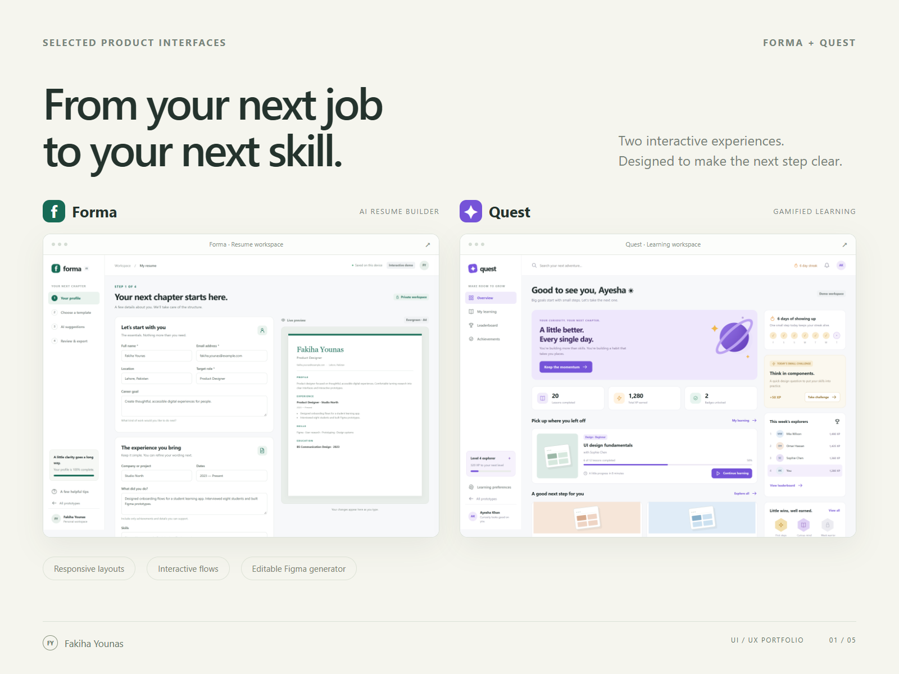
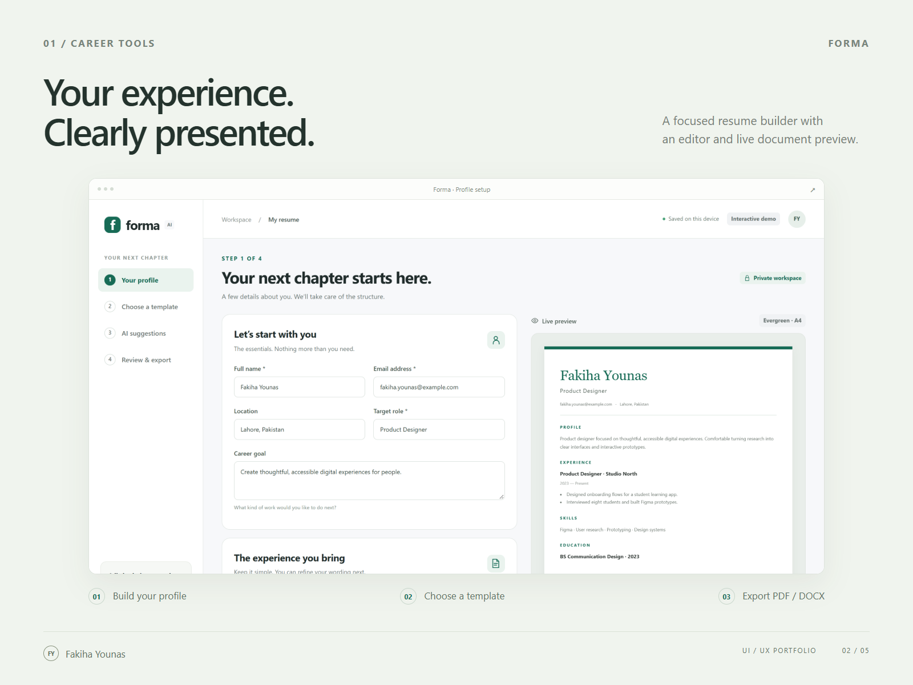
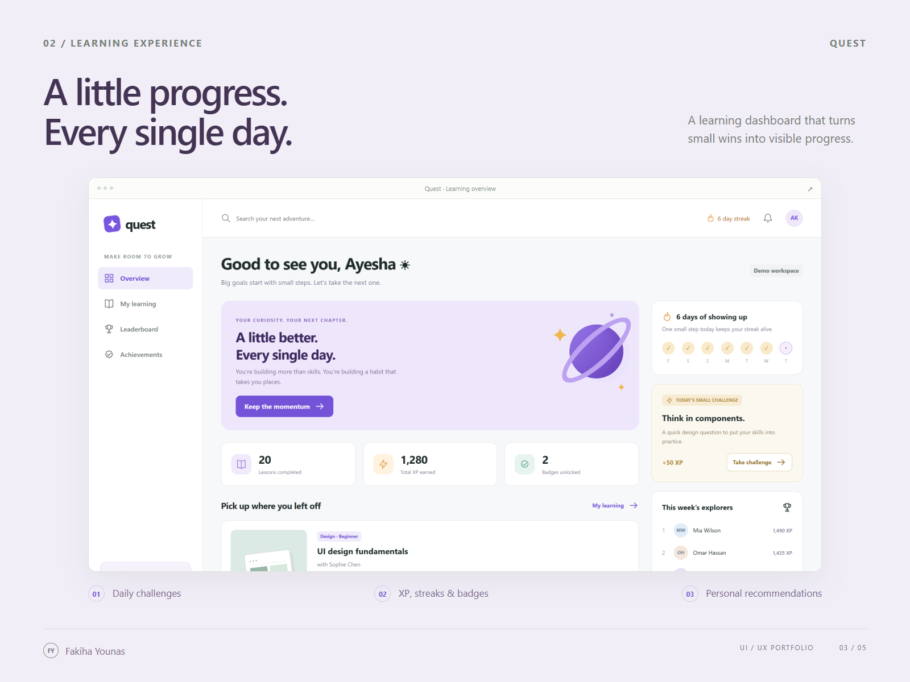
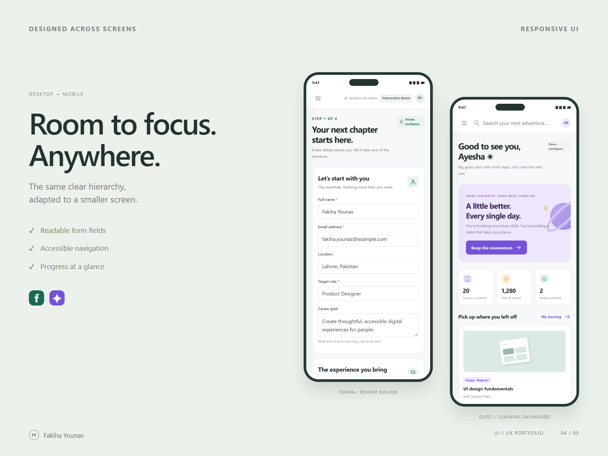
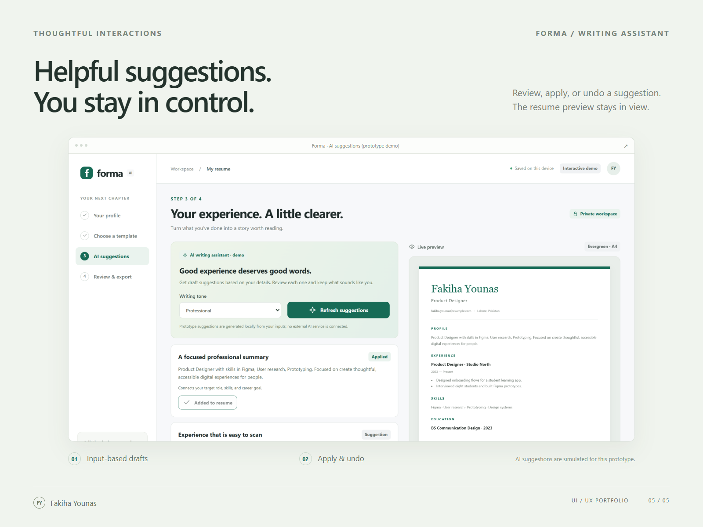

# Forma + Quest

Interactive UI prototypes presented by **Fakiha Younas**: a resume builder and a gamified learning dashboard.

**Repository:** [mrjerry675/forma-quest-ui](https://github.com/mrjerry675/forma-quest-ui)



## Explore the prototypes

Download the repository and open `index.html` in Chrome or Edge. No account, build step, or server is required.

| Prototype | What you can try |
| --- | --- |
| **Forma** — `resume.html` | Edit a profile, switch templates and colors, preview changes, apply or undo writing suggestions, and download PDF or DOCX files. |
| **Quest** — `learn.html` | Complete lessons, earn XP, answer a daily challenge, track streaks, unlock badges, explore the leaderboard, and discover courses. |

The layouts adapt to desktop and mobile. Demo progress and edits save locally in the browser. AI suggestions are simulated from your inputs; PDF and DOCX exports are functional. Learners, experience, and activity shown in the demos are sample content.

## Screenshots

### Forma resume builder



### Quest learning dashboard



### Mobile layouts



### Writing suggestions



Original UI captures are in [`docs/screenshots`](docs/screenshots). The five presentation images in [`docs/linkedin`](docs/linkedin) are 1600 × 1200 PNG files.

## Editable Figma screens

The generator in [`figma-plugin`](figma-plugin) defines 20 editable screens with Auto Layout, component variants, and Smart Animate prototype connections.

1. Open a Design file in the Figma desktop app.
2. Choose **Plugins → Development → Import plugin from manifest**.
3. Select `figma-plugin/manifest.json` and run **Forma + Quest — Editable UI Prototypes**.
4. Choose the Forma or Quest flow and click **Present**.

The generator adds a new page. Its code and structure have been checked, but it has not been executed inside Figma here. Figma uses prepared interaction states; live typing and downloads work in the browser versions. The two mobile Figma entry screens link into the desktop flows.

## Design and implementation

- Forma: forest green, a focused editing flow, and a persistent document preview.
- Quest: purple accents, visible progress, and clear feedback for achievements.
- HTML, CSS, and JavaScript with local jsPDF and docx export libraries.
- Editable TypeScript source for the Figma generator.
- Labeled inputs, keyboard controls, focus indicators, and responsive layouts.

## Development

```sh
npm ci
npm run figma:build
npm run test:figma
npm run test:browser
```

The browser test expects Windows Chrome at `C:/Program Files/Google/Chrome/Application/chrome.exe`; change that path for another environment. Figma structural tests use a mock API and do not validate native rendering.

Browser checks cover profile validation, editing, template changes, suggestions and undo, downloads, persistence, rewards, course search, preferences, and mobile navigation. See `browser-validation.json` and `figma-validation.json` for the recorded checks.

Open `handoff.html` for the full project guide. Third-party notices are included in `vendor/licenses`.
